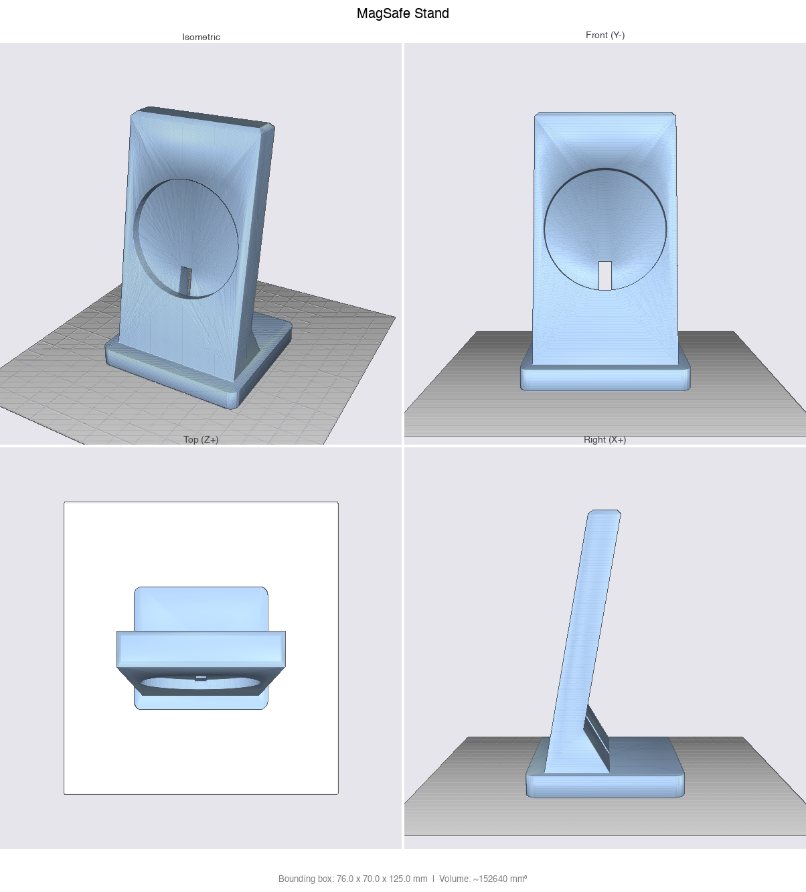
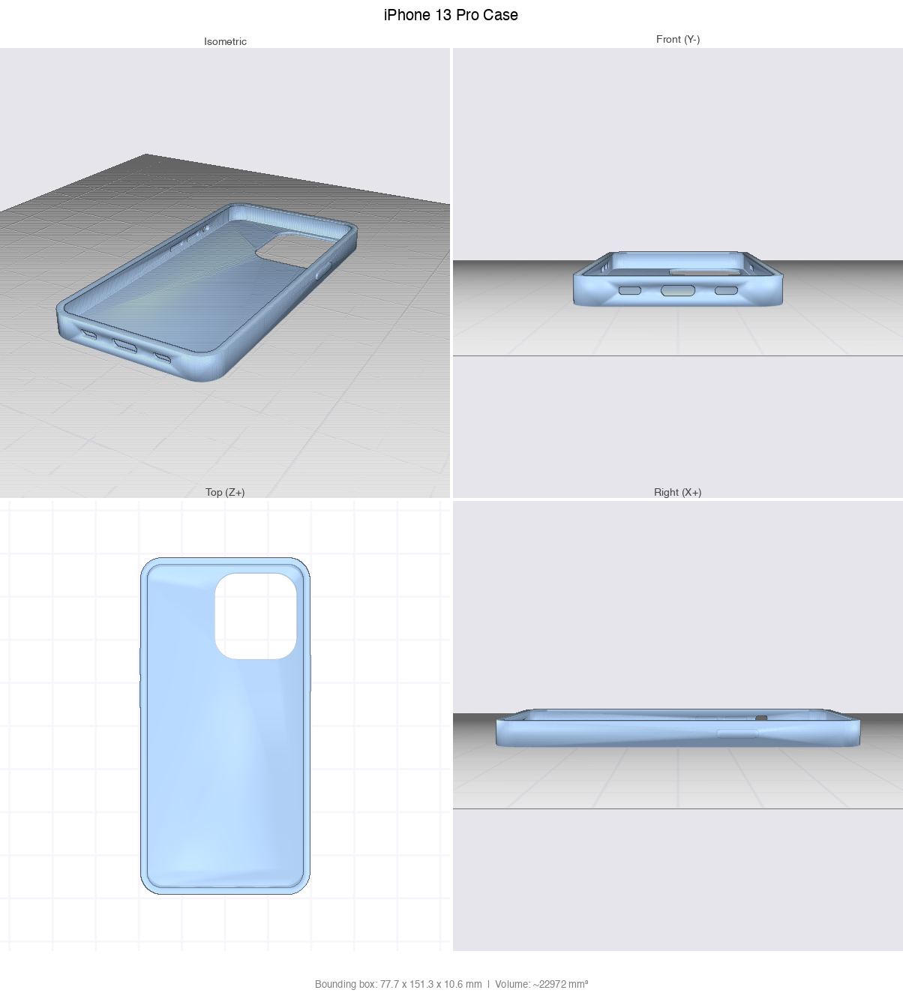
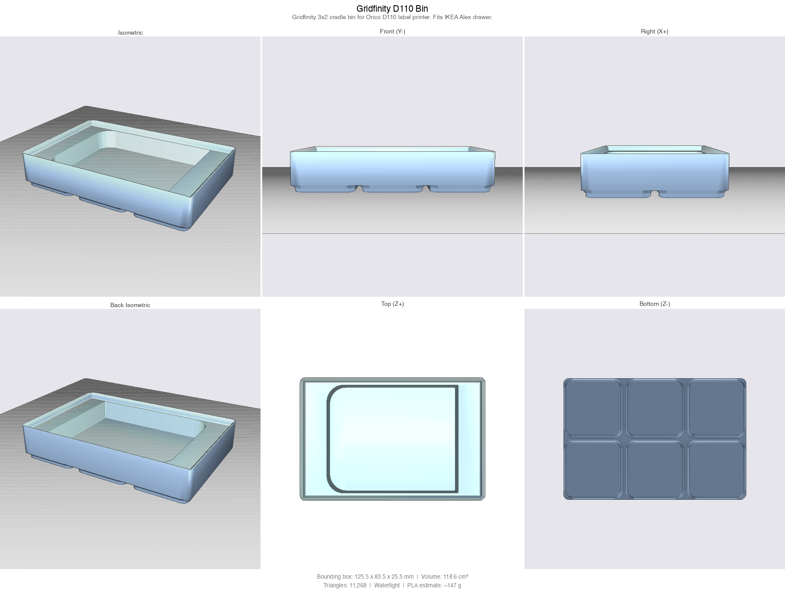
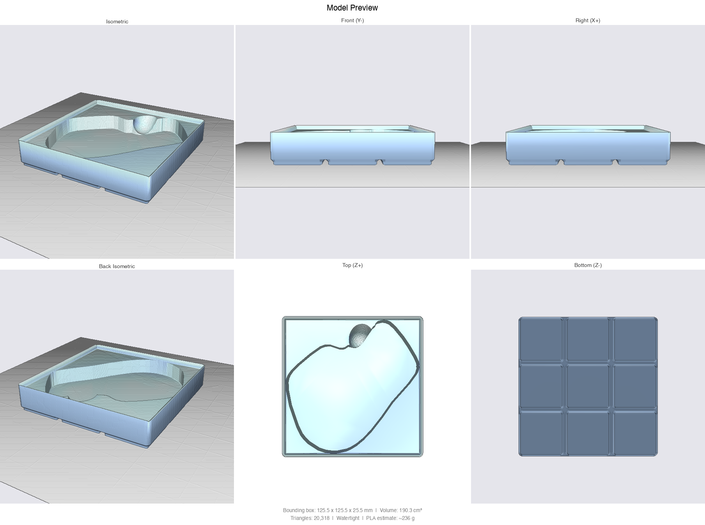
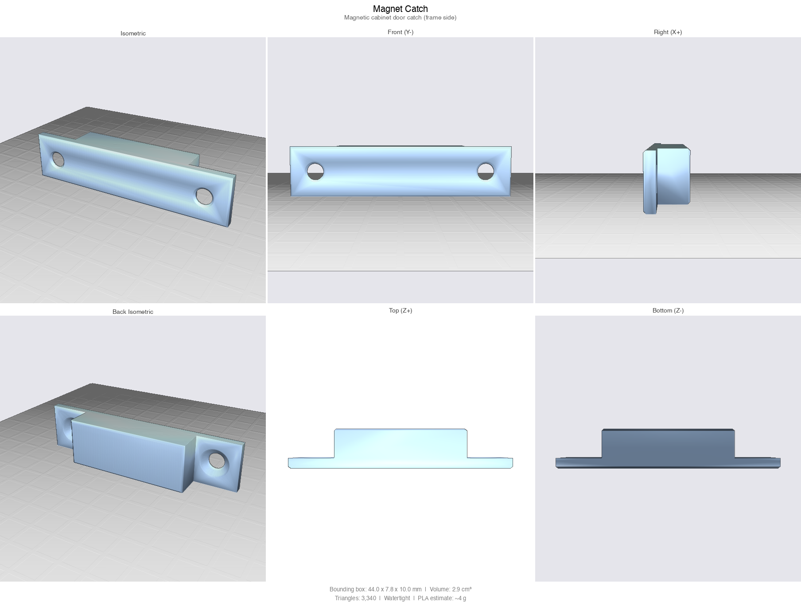
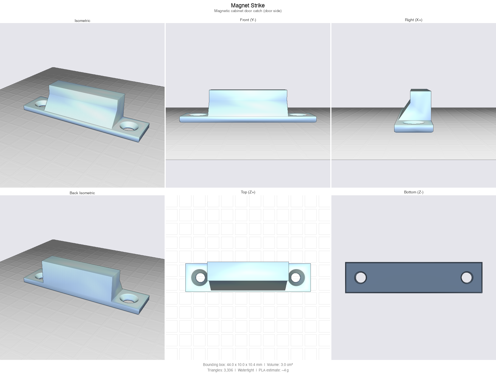

# CAD Skill for Claude Code

> **Fork note.** This is a derivative of [flowful-ai/cad-skill](https://github.com/flowful-ai/cad-skill)
> by Nicolas Chourrout, published here under the **same** license
> ([PolyForm Noncommercial 1.0.0](LICENSE) — noncommercial use only).
> Adds: importing/reverse-engineering an existing STL, a structural-efficiency
> review standard, and two analysis tools (`analyze_stl.py`, `plane_fea.py`).
> See [What this fork adds](#what-this-fork-adds) below.

A [Claude Code](https://docs.anthropic.com/en/docs/claude-code) skill for designing and optimizing parametric physical parts using [CadQuery](https://cadquery.readthedocs.io/). Describe a physical object, and Claude will write a parametric script, export STL/STEP, render previews, and iterate with you until it's right.

It also works the other way round: **hand it an existing STL and it will measure the part, reverse-engineer it into editable parametric code, and optimize it for structural efficiency** — more strength where the load path needs it, less material everywhere else. Printability is treated as a constraint on that goal, not the goal itself.

<p align="center">
  
  
</p>

Read the full write-up: [I Taught Claude to Design 3D-Printable Parts. Here's How](https://medium.com/@nchourrout/i-taught-claude-to-design-3d-printable-parts-heres-how-675f644af78a)

## More examples

Published on [MakerWorld](https://makerworld.com/en/@sercanto).

<p align="center">
  
</p>

<p align="center">
  
</p>

The MX Master 3 bin above ([examples/mx_master3_bin_3x3.py](examples/mx_master3_bin_3x3.py), [printed and published on MakerWorld](https://makerworld.com/en/models/3049470-gridfinity-bin-for-logitech-mx-master-3-3x3)) shows the scan-to-pocket pipeline: `outline_from_scan.py` traces the mouse's real footprint from a 3D scan, the outline is rotated to the angle that minimizes its bounding square so the bin fits a 3x3 grid instead of 4x3, and a tilted thumb scoop ramps under the thumb rest to lift the mouse out.

<p align="center">
  
  
</p>

## Installation

```bash
mkdir -p ~/.claude/skills
git clone https://github.com/flowful-ai/cad-skill ~/.claude/skills/parametric-3d-printing
```

## Usage

Once installed, the skill activates in two ways inside Claude Code:

- **Auto-trigger.** Describe a part you want to print ("design a wall mount for an Arduino Uno", "I need a snap-fit lid for this box") and Claude picks up the skill from its trigger keywords (3D print, STL, CadQuery, enclosure, bracket, and so on).
- **Explicit slash command.** Type `/parametric-3d-printing` to invoke it directly, useful when your request does not contain the obvious keywords.

Claude will then walk you through requirements, build the model in phases (base shape, features, finish), and deliver an STL plus a rendered preview.

### Importing an existing mesh

```bash
python analyze_stl.py part.stl --density 1.24            # measure it
python analyze_stl.py part.stl --compare optimized.stl   # before/after
```

Claude measures the mesh (envelope, mass, wall thickness, bores and
pockets, overhangs, cross-sections), rebuilds it as a parametric script,
verifies the rebuild against the original, then optimizes it and reports
mass / min wall / corner radius / support area side by side.

## Dependencies

Requires **Python 3.10-3.12** (CadQuery's OCC kernel does not have wheels for 3.13+):

```bash
python3.12 -m venv .venv && source .venv/bin/activate
pip install -r requirements.txt
```

## Files

| File | Purpose |
|------|---------|
| `SKILL.md` | Skill definition and workflow instructions for Claude |
| `gridfinity.py` | Tested Gridfinity bin generator (base profile, stacking lip, magnets, compartments, custom pockets). Vendored next to generated scripts. |
| `outline_from_scan.py` | Extracts a pocket outline from a 3D scan of an object (align, scale, slice, union), ready for `add_polygon_pocket`. |
| `examples/` | Model scripts built on the gridfinity module (D110 cradle, MX Master 3 diagonal bin). |
| `preview.py` | Headless STL to 6-view PNG renderer (trimesh + pyrender). Use `--strict` to fail on non-watertight meshes. |
| `run_cadquery_model.py` | Subprocess wrapper that runs a CadQuery script, captures errors, optionally renders the preview, and emits a JSON result so Claude can self-correct in a loop. |
| `mesh_io.py` | STL loading with validation (no pyrender dependency). Used by the wrapper and converter. |
| `stl_to_3mf.py` | Standalone STL to 3MF converter for Bambu Studio / PrusaSlicer. |
| `design-review.md` | Visual inspection checklist and printability analysis |
| `structure-review.md` | Structural checklist: load path, stress concentrators, rib and pocket rules, print anisotropy, before/after reporting |
| `analyze_stl.py` | Reverse-engineer an existing mesh: envelope, mass, wall thickness per axis, hole/pocket detection, overhang audit, ASCII cross-sections, A/B compare |
| `plane_fea.py` | Variable-thickness plane-stress FEA on a cross-section. Ranks design variants by stiffness and stiffness-per-gram when section properties alone cannot (e.g. a triangulated bracket). |
| `requirements.txt` | Pinned dependency versions |

## What this fork adds

1. **Importing an existing STL is a first-class workflow.** Upstream explicitly
   refused to touch meshes the user already had. This fork replaces that with
   measure -> rebuild parametrically -> verify (volume within ~2%) -> optimize,
   so optimization never happens on a model that was not first reproduced.
2. **Structural efficiency is the goal; printability is a constraint.**
   Upstream optimized for printability. This fork adds `structure-review.md`
   (load path, stress concentrators, rib/pocket rules, FDM anisotropy,
   mandatory before/after metrics) and treats manufacturing limits as
   boundaries on that goal, not the objective.
3. **Two tools:** `analyze_stl.py` (measurement + A/B compare) and
   `plane_fea.py` (stiffness ranking across variants).

Everything else — workflow, Gridfinity module, preview/wrapper scripts,
tests — is upstream. `pytest tests` → 32 passed, no regressions.

If you do not need the print-oriented flow, you can also tell the skill the
part will be machined or cast; it then drops the 45-degree and support-free
rules and uses closed sections, ribs and triangulation.

## License

The skill and scripts are licensed under the [PolyForm Noncommercial License 1.0.0](LICENSE). Free to use, modify, and distribute for noncommercial purposes.

---

Created by [Nicolas Chourrout](https://github.com/nchourrout) from [Flowful.ai](https://flowful.ai)
